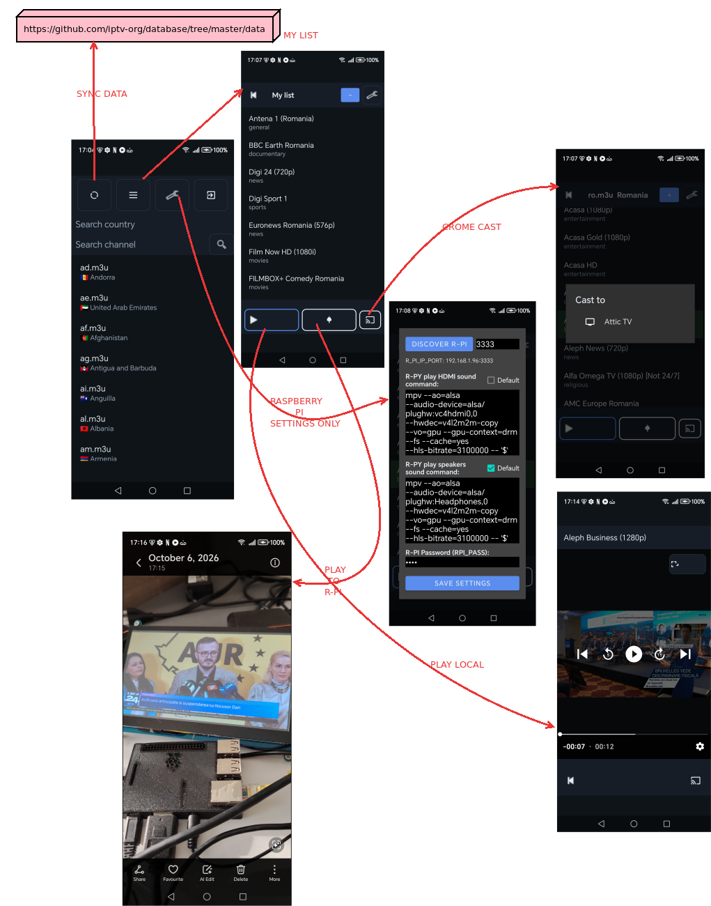
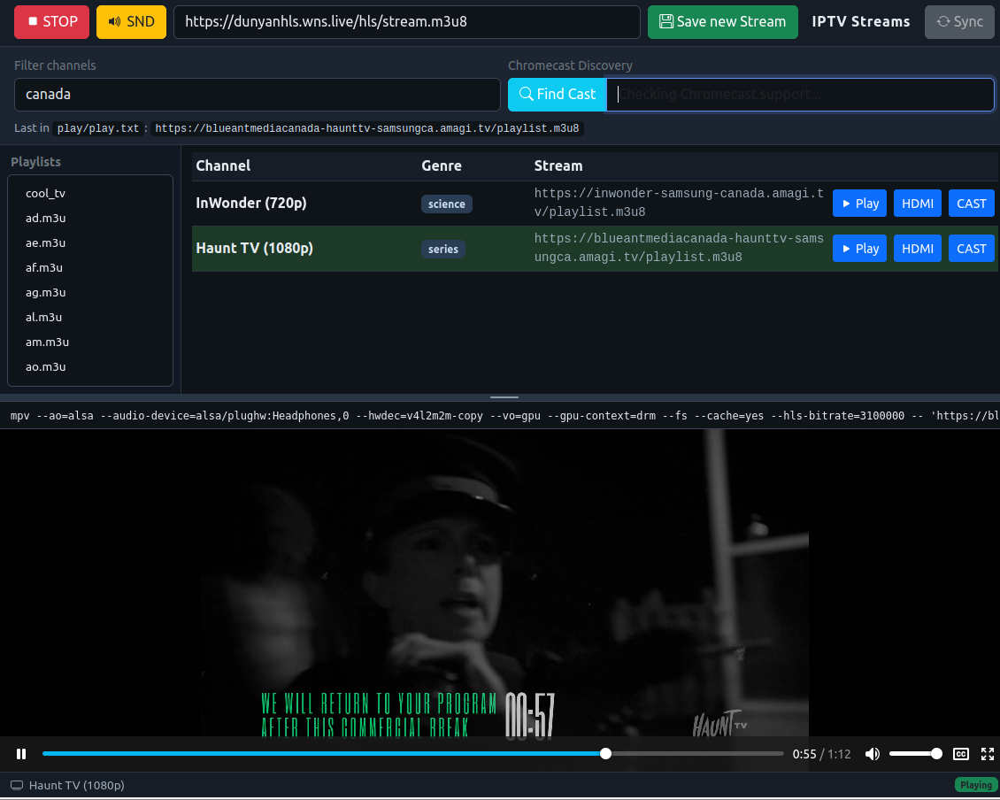

# APK to: play TV local, on Chrome cast and on R-PI 
[Buy me a coffee](https://www.paypal.com/ncp/payment/UY6RJK9AQ6HVC)
-- --
Transforms the R-PI to a 'chrome cast'. 
APK application can play TV locally (Android phone), to Google Chrome cast, or cast to a R-PI (after you install this app on R-PI) . The R_PI will play all TV codecs, while The Chrome will not decode.
This is not a screen cast, will work only with tv internet streams or youtube links.
It uses the Chrome Cast API to tell it from whet link to stream.
For R-PI is the same, detects the R-PI on your netowrk, then sends the link to R-PI
and tell to R-PI to play the stream. When installing the R-PI youre asked for a password.
On the APK settings you have to provide same password. That is the ecnryption key
on which the APK encrypts the data sent to R-PI, just for the sake of it.


-- -- 
### Used by APK in the APK folder for alternative cast option beside ChromeCast

[this repo is private, ](https://github.com/circinusX1/fast-iptv-apk-code) utill I drink some coffee. 
Until then use precompiled APK app. Is clean.

runs this service.

```
./install.sh

```
Then on the fast-tv app  on the Android phone on the App
goto settings and discover the RPI. Then save settings.
Now you can cast TV statoins which the ChromeCast cannot decode to R-PI.
You can select AUDIO from the App settings to be over HDMI or over speakers.

-- --



# Bonus web_server

This is the web versin of the APK simplified.

You can run it locally if you have apache2 or lighttpd with PHP
emabled, otherwise the simpler way is with just php:

```
php -S localhost:8000 # in the folder where index.php is located.
```

If you deploy it on a R-PI or an a board with HDMI and a good video card,
then you can access it by IP. Audio HDMI/Speakers play frmo the left top buttons.
Then you play it by pressing HDMI button over the HDMI.



[WebDemo](https://ghitara.com/fast-tv)


